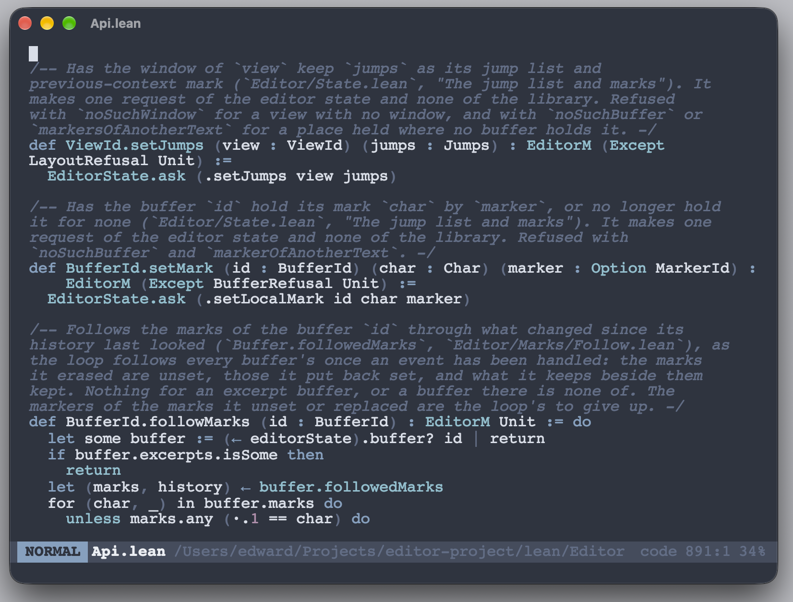

# leanmacs

[](LICENSE)

An Emacs-style editor with Vim's keys, configured and extended in Lean.

Lean owns the process: the editor's state, command loop, commands, modes,
keymaps and config are Lean. A Rust library linked into the Lean
executable handles text storage, layout, rendering, the window and
processes.



## Limitations

- No mouse support.
- Highlighting covers Rust, JSON, Markdown, TOML and Lean only. Grammars
  are compiled in, so adding one means rebuilding the editor.
- A pending key prefix and input-method composition are not shown on
  screen.
- A config that fails to reload shows only its first error in the window;
  the rest go to stderr.
- Installing or removing a package rebuilds the editor and restarts it;
  packages are not loaded or unloaded while it runs.
- The app ships only the Lean toolchain. A package's native code is a
  library loaded when the editor starts: one the package ships already
  built needs no Cargo or compiler at `:reload`, and one its lakefile
  builds needs your own tooling (Cargo, zig, a C compiler), as its
  documentation says ([installing-packages.md](docs/packages/installing-packages.md)).

## Download

The nightly is a rolling build of `main`, replaced on each push that passes
the gate. It needs macOS 26.0 or later on Apple silicon. On Linux, build
from source. There are no versioned releases and no self-update.

- Download page: <https://leanmacs.github.io/leanmacs/>
- Latest image: <https://github.com/leanmacs/leanmacs/releases/download/nightly/Leanmacs.dmg>

Open the image and drag Leanmacs.app onto Applications. The app is not
notarized, so macOS blocks the first launch:

1. Open Leanmacs. When macOS says it cannot check it, click Done.
2. In System Settings > Privacy & Security, click "Open Anyway" beside the
   message about Leanmacs.
3. Open Leanmacs again and confirm.

Or remove the quarantine flag:

```sh
xattr -dr com.apple.quarantine /Applications/Leanmacs.app
```

`/Applications/Leanmacs.app/Contents/MacOS/editor --version` prints the
version, build ID and commit.

## Config

Config is Lean modules in `~/.config/leanmacs` (or
`$XDG_CONFIG_HOME/leanmacs`), and that directory is also a Lake package
whose `lakefile.toml` names the packages your editor is built from:

```
init.lean            defines `setup`, which the editor runs
Config/Keys.lean     other files, imported as `Config.Keys`
lakefile.toml        your package set; generated when absent
lean-toolchain       generated when absent
```

Each file starts with `import Editor` and `open Editor`. It may also import
`Lean`, `Std`, modules from packages the editor was built with, and other
config files under `Config/`. Only the `setup` in `init.lean` runs; other
files export their own definitions for it to call.

The config loads at start and on `:reload`. A reload re-elaborates only the
changed files and their importers. If it fails, the old config keeps
running.

Example `init.lean`:

```lean
import Editor
open Editor

def hello : EditorM Unit :=
  message "hello from my config"

def setup : SetupM Unit := do
  useTheme "solarized-dark"
  framePadding 12
  autoReload                        -- follow files changed on disk
  command "say-hello" hello
  bindKey "C-c h" "say-hello"
  exCommand "hello" "say-hello"     -- :hello
```

Everything `setup` can register is in
[`lean/Editor/Setup.lean`](lean/Editor/Setup.lean). The configs under
[`tests/headless/`](tests/headless/) are small working examples.

The generated `lakefile.toml` and `lean-toolchain` let Lean's language
server check config files from any editor. The editor never overwrites
them. Don't add `init` to the lakefile's library: on a case-insensitive
file system it collides with Lean's `Init`. The app writes both, naming the
package set it ships.

An older config (flat `.lean` files with no headers) is refused. Convert it
from a checkout with `mise run config-migrate [-- <dir>]`.

### Packages

A package is a Lake package of Lean code written against the same API as
config. The editor ships with two default packages, `shipped-themes` and
`compile`. Add, update and remove packages with `:package-install`,
`:package-update` and `:package-remove`, or by editing `lakefile.toml` and
running `:reload`. The editor rebuilds itself in the background, shows the
build in `*package-build*`, and restarts into the new build with your
buffers, windows and tabs. If the build fails, the current editor keeps
running. Git and Reservoir packages need `git`.

Packages run with your authority, as config does: a package's code, its
`initialize` included, can do anything you can.

- [Installing packages](docs/packages/installing-packages.md): the
  commands, editing the lakefile, failed builds and editor updates.
- [Writing a package](docs/packages/writing-a-package.md): from a config
  file to a package, with a worked example.

Started from Finder, the app gets launchd's environment, so set
`XDG_CONFIG_HOME` with `launchctl setenv` rather than in your shell.

## Building

Builds on macOS and Linux. The app bundle builds on macOS arm64 only.

### Prerequisites

- [mise](https://mise.jdx.dev), which installs the pinned tools and runs
  every task, plus `uv` or `pipx` (mise uses one for clang-format).
- Lean at exactly the version in `lean/lean-toolchain`, with `lean` and
  `lake` on the `PATH`. `mise install` does not provide it; use
  [elan](https://github.com/leanprover/elan), or mise's `lean` plugin with
  `idiomatic_version_file_enable_tools = ["lean"]`.
- A C compiler at `/usr/bin/cc`: the Xcode command line tools on macOS, or
  gcc and libc headers on Linux (Debian's `build-essential`).
- On Linux, also `git`, `curl`, `zstd`, `pkg-config` and the X11 libraries.
  `tools/linux/Dockerfile` has the full list for Debian 13.

### Build and run

```sh
mise install            # once
mise run lean           # build everything
mise run edit -- [<file>]
```

Use `mise run lean`, not `lake build`
([why](docs/dev-practices/building.md)). `mise run edit` builds, then opens
the file through the app's launcher with the pinned toolchain, so config
loads and the newest build of your own package set runs. Options go before
the file: `--config <dir>`, `--no-ime`, and the measurement flags in
[on-demand-checks.md](docs/dev-practices/on-demand-checks.md).

### The macOS app

```sh
mise run app          # build packages/.lake/build/Leanmacs.app
mise run install      # build, check, and replace /Applications/Leanmacs.app
mise run dmg          # pack dist/Leanmacs-<build-id>.dmg
```

`mise run install` keeps no backup. If `~/.config/leanmacs` doesn't exist,
it installs [`config/default`](config/default/init.lean), a Doom-style
`SPC` leader map (`SPC f f` finds a file). To add that map to an existing
config, copy `config/default/Config/Leader.lean` into its `Config/`,
import `Config.Leader` and call `leaderMap` from `setup`.

## Contributing

- [`AGENTS.md`](AGENTS.md): working rules (test-first, ports and adapters,
  conventional commits).
- `mise run ci` runs the gate ([`the-gate.md`](docs/dev-practices/the-gate.md)).
- [`docs/dev-practices/`](docs/dev-practices/README.md): building, testing,
  CI, the nightly and publishing.
- [`docs/design/`](docs/design/README.md): what is being built and why.

## Licence

GPL-3.0-or-later. See [`LICENSE`](LICENSE).
